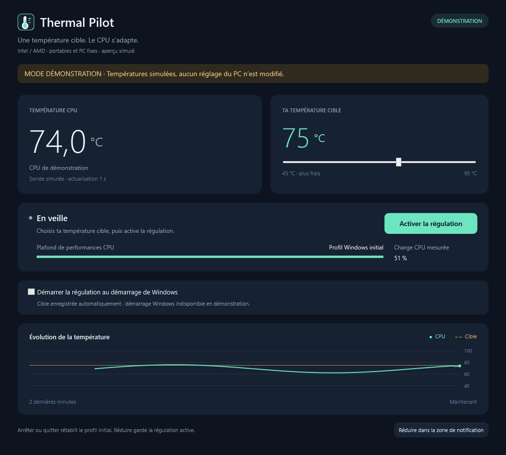

# Thermal Pilot

Utilitaire Windows natif en français : définir une température CPU cible et laisser l’application réduire automatiquement le plafond de performances Windows au-dessus de cette cible.

**[Télécharger l’installeur Windows x64](https://github.com/MonkeyTime/ThermalPilot/releases/download/v0.3.4/ThermalPilot-0.3.4-Setup-x64.exe)** · [Version portable et empreintes SHA-256](https://github.com/MonkeyTime/ThermalPilot/releases/latest)

La version **0.3.4** propose une température cible unique, un bridage progressif, un retour des performances après refroidissement, une icône de notification et un démarrage automatique optionnel à l’ouverture de session Windows. Elle conserve la régulation lorsque le jeu ou un utilitaire constructeur change le profil d’alimentation. Elle vise les processeurs Intel et AMD x64 sur portables et PC fixes. La compatibilité thermique reste dépendante du matériel et du firmware.

**PawnIO s’installe séparément** s’il manque ; .NET est déjà inclus dans les téléchargements. L’application nécessite les droits administrateur pour la régulation. Consulte les prérequis et les limites ci-dessous avant utilisation.



## Compatibilité de la version 0.2

La prise en charge vise plusieurs modèles Intel et AMD **x64**, sur ordinateurs portables et de bureau. Aucun modèle de CPU, constructeur de PC ou type de châssis n’est codé comme condition d’activation. L’Intel Core Ultra 9 275HX est la machine de référence détectée sur le poste de développement.

| Famille de machine | Stratégie | Validation matérielle |
| --- | --- | --- |
| Intel Core / Core Ultra, portable ou fixe | Sondes LibreHardwareMonitor et classes de performances Windows disponibles | Selon les sondes et le firmware ; 275HX détecté, réglages lisibles, température à valider en administrateur |
| AMD Ryzen et autres AMD x64, portable ou fixe | Même boucle thermique et même politique Windows | À vérifier sur chaque machine cible |
| CPU hybrides | Découverte des classes Windows 0, 1 et 2 exposées, appliquées sur secteur et batterie | Tests logiciels ; présence d’une classe Windows ne prouve pas la topologie physique des cœurs |
| Plusieurs sockets CPU détectés | Température la plus chaude ; plafond global Windows | Tests logiciels ; aucune régulation indépendante par socket |
| Windows ARM64 | Non pris en charge par cette distribution | Activation bloquée |

L’application affiche le nombre de classes Windows accessibles et la couverture des sondes CPU. Elle vérifie en lecture seule la cohérence des plafonds minimum et maximum sur secteur et batterie avant activation. Un jeu de réglages incomplet empêche la régulation. Si plusieurs CPU sont détectés, chacun doit avoir au moins une température valide ; la perte complète des sondes de l’un d’eux déclenche le mode de secours.

Ces vérifications établissent la disponibilité des mesures et des réglages ; elles ne certifient pas leur efficacité thermique. La compatibilité universelle n’est pas revendiquée : un firmware ou un logiciel constructeur peut limiter l’effet des politiques Windows. Le diagnostic exporté inclut la couverture des sondes et les classes Windows détectées pour faciliter les essais sur d’autres machines.

## Utilisation

### Installeur Windows (version 0.3.2)

Exécuter `ThermalPilot-0.3.3-Setup-x64.exe`. L’assistant en français installe l’application pour le compte Windows courant, par défaut dans `%LOCALAPPDATA%\Programs\ThermalPilot`, ajoute une entrée au menu Démarrer et propose un raccourci sur le bureau. L’application apparaît dans les applications installées de Windows pour sa désinstallation. .NET est inclus ; **PawnIO reste à installer séparément** s’il manque. La dernière page de l’assistant propose d’ouvrir sa page officielle.

Fermer Thermal Pilot depuis son icône de notification avant une mise à jour ou une désinstallation. La désinstallation supprime la tâche de démarrage du compte courant si elle pointe vers le dossier désinstallé, rétablit un éventuel profil temporaire et conserve la température cible. Une tâche liée à une autre copie de Thermal Pilot reste en place. Si ces opérations nécessitent les droits administrateur, une élévation est demandée. L’application doit utiliser le même compte Windows pour ce nettoyage. PawnIO reste installé pour les autres utilitaires qui pourraient l’utiliser.

Après un passage de la version portable à la version installée, si le démarrage automatique pointait vers l’ancien dossier, décocher puis recocher l’option dans la nouvelle installation. L’application signale cette situation.

### Version portable ZIP

1. Extraire **tout** le ZIP `ThermalPilot-win-x64.zip` dans un dossier.
2. Si nécessaire, installer [PawnIO depuis le projet officiel](https://github.com/namazso/PawnIO.Setup/releases/latest). Le bouton « Installer PawnIO… » ouvre cette page ; l’application n’installe aucun pilote automatiquement.
3. Lancer `ThermalPilot.exe`, puis « Relancer en administrateur » si proposé.
4. Attendre une température CPU valide, choisir une cible entre 45 et 95 °C, puis cliquer sur **Activer la régulation**.
5. Réduire dans la zone de notification pour continuer en arrière-plan. **Arrêter**, fermer la fenêtre, ou **Arrêter et quitter** dans l’icône de notification rétablit le profil initial.

### Démarrage Windows et mémorisation (version 0.3)

L’option **« Démarrer la régulation au démarrage de Windows »** se configure en administrateur. Elle crée une tâche planifiée propre à l’utilisateur, déclenchée dix secondes après l’ouverture de sa session Windows. L’application démarre dans la zone de notification avec les droits élevés de cet utilisateur, recharge la dernière cible et active la régulation dès qu’une mesure CPU valide et le contrôle Windows sont disponibles. Aucun mot de passe n’est enregistré. Elle fonctionne également sur batterie, sans arrêt programmé après quelques jours. L’option est désactivée par défaut et indisponible en démonstration.

La cible est sauvegardée immédiatement à chaque changement du curseur, avant les actions de régulation et à la fermeture, dans `%LOCALAPPDATA%\ThermalPilot\settings.json`. L’écriture utilise un fichier temporaire puis un remplacement atomique, avec vidage sur disque avant remplacement. Le format des versions précédentes contenant seulement `Target` reste accepté. Les préférences de démonstration sont séparées.

Décocher l’option supprime la tâche `ThermalPilot-<SID utilisateur>`. Cela ne coupe pas une régulation déjà active : utiliser **Arrêter la régulation** pour l’arrêter. À l’inverse, quitter l’application rétablit le profil Windows et conserve l’option pour la prochaine ouverture de session. Un lancement manuel ordinaire reste en veille ; seule l’exécution avec `--startup` et une préférence activée déclenche le démarrage automatique. Si les sondes sont indisponibles, le démarrage reste en attente et l’icône permet d’ouvrir l’application pour voir la cause.

Conserver le dossier extrait à son emplacement après activation : la tâche utilise le chemin absolu de l’exécutable. Pour déplacer ou supprimer le dossier, décocher l’option auparavant ; la réactiver depuis le nouveau dossier si nécessaire. Le lancement se fait **à l’ouverture de session**, afin de fournir une icône de notification interactive, et non avant la connexion de l’utilisateur.

### Icônes Windows (version 0.2.1)

Une icône de thermomètre est intégrée à l’exécutable, à la fenêtre et à la barre des tâches. L’icône de la zone de notification reste disponible lorsque la fenêtre est réduite ou masquée. Son repère indique l’état : gris en veille, vert en régulation sans bridage, orange lorsque le plafond est réduit ou la cible dépassée, rouge si une sonde manque ou qu’une erreur survient. Le survol affiche la température et l’état ; un double-clic rouvre la fenêtre, et le clic droit permet d’ouvrir ou de quitter.

Les icônes contiennent neuf résolutions de 16 à 256 pixels pour les différents affichages Windows. Leurs sources vectorielles sont dans `src/ThermalPilot/Assets/` ; `scripts/New-AppIcons.ps1` régénère les fichiers `.ico` et leurs aperçus. Windows peut ranger l’icône dans le menu des icônes masquées : elle peut être déplacée près de l’horloge dans les réglages de la barre des tâches.

### Fenêtre et défilement (version 0.3.1)

La fenêtre initiale mesure 1050 × 970 unités Windows et sa hauteur est limitée à la zone de travail disponible. Le contenu tient sans défilement à cette taille avec l’affichage vérifié. Si une fenêtre réduite, un écran plus petit ou un texte plus long impose un défilement, la barre verticale utilise une poignée arrondie de 4 unités, élargie à 6 au survol et colorée en vert pendant le déplacement. La zone interactive reste large de 12 unités. La molette et les clics dans la piste restent disponibles.

Windows 10/11 **x64**. Le paquet portable inclut .NET 10 ; aucun SDK n’est nécessaire pour l’utiliser. Les réglages nécessitent les droits administrateur. La lecture dépend des sondes prises en charge par LibreHardwareMonitor et des permissions du pilote PawnIO. Relancer l’application après l’installation du pilote.

## Régulation

- Mesure environ chaque seconde : température la plus élevée des sondes CPU valides, y compris les cœurs. Les zones thermiques ACPI de la carte mère ne servent pas de substitut.
- Au-dessus de la cible : baisse de 5 points par mesure ; 10 points dès +5 °C, 20 points dès +10 °C. Plancher : 15 %.
- À la cible ou dans les 3 °C en dessous : maintien du plafond courant.
- À cible −3 °C ou moins pendant quatre mesures consécutives : remontée de 2 points ; répétée jusqu’au plafond initial.
- Perte de mesure pendant la régulation : plafond de secours à 15 %. La remontée reste progressive lorsque la sonde revient. L’activation est impossible sans mesure valide de moins de trois secondes.
- La cible seule se règle ; les paliers et l’hystérésis sont internes.

Le plafond affiché est un **réglage de performances Windows**, pas une mesure de charge, de fréquence, de puissance ou un pourcentage de throttling matériel. Il est appliqué sur secteur et batterie, aux classes de CPU hybrides exposées par Windows. Les limites du profil initial ne sont jamais augmentées.

Le CPU est le seul composant régulé dans cette version. Aucun contrôle GPU, voltage, ventilateur ou limite matérielle SMU/MSR n’est implémenté. La température cible est un objectif de boucle logicielle, pas une garantie de maximum instantané : des dépassements restent possibles, et l’efficacité de la politique Windows dépend du matériel, du firmware et des utilitaires constructeur. Les protections thermiques matérielles restent actives.

## Restauration

L’application duplique le profil actif et modifie uniquement cette copie temporaire. Le profil original conserve ses valeurs. Un journal est enregistré **avant** toute modification dans `%LOCALAPPDATA%\ThermalPilot\power-session.json`.

Un processus de secours indépendant, démarré avant l’activation, restaure le profil après la mort de l’application ou après 15 secondes sans signal de vie. Au lancement suivant, un journal résiduel est également restauré. En cas d’échec de restauration, le journal est conservé pour permettre une nouvelle tentative.

Depuis la version 0.3.4, les écritures du journal sont forcées sur disque avant les changements de profil. Une copie de secours indépendante conserve les informations de restauration et permet de récupérer un journal principal illisible ou absent. Si les deux copies sont inutilisables, l’application conserve les fichiers et indique de sélectionner le profil habituel dans Windows.

Depuis la version 0.3.3, un changement de profil Windows ne coupe plus la régulation. L’application suit le nouveau profil via sa propre copie temporaire, en conservant la cible et le plafond thermique courant. Les copies sont réutilisées lors des allers-retours entre profils ; si un jeu restaure une copie temporaire enregistrée au lancement, celle-ci est rattachée à son véritable profil source. À l’arrêt, le dernier profil source sélectionné est rétabli et toutes les copies sont supprimées. Les profils d’origine ne sont pas modifiés. Les bascules très rapides sont traitées avec un nombre limité de tentatives par mesure et une reprise à la mesure suivante, pour éviter une boucle bloquante. Un message d’erreur réel reste affiché au lieu de disparaître derrière « En veille ».

Après une coupure complète de Windows, aucun processus ne peut exécuter de restauration : relancer Thermal Pilot pour restaurer le profil. En dépannage, sélectionner manuellement le profil d’origine dans les options d’alimentation. Le journal contient son GUID dans `Original` ; `powercfg /setactive GUID` permet de le réactiver. Ne pas effacer ce journal avant restauration.

Le lancement et la régulation automatiques sont optionnels via une tâche planifiée ; aucun service Windows n’est installé. La cible et la préférence de démarrage sont conservées dans `%LOCALAPPDATA%\ThermalPilot\settings.json`. Les erreurs sont dans `errors.log` (rotation à environ 1 Mo).

## Compilation et vérification

Installer le SDK .NET 10, puis depuis le dépôt :

```powershell
dotnet build src/ThermalPilot/ThermalPilot.csproj -c Release
dotnet test tests/ThermalPilot.Tests/ThermalPilot.Tests.csproj -c Release
./scripts/publish.ps1
# Générer aussi l’installeur (nécessite le compilateur Inno Setup 6)
./scripts/build-installer.ps1 -SkipPublish
```

Le script détecte aussi un SDK local dans `.tools/dotnet`. La sortie est dans `dist/ThermalPilot-win-x64/` et le ZIP correspondant. L’exécutable n’est pas signé.

`build-installer.ps1` détecte Inno Setup dans `.tools/InnoSetup`, son dossier d’installation standard ou via `-CompilerPath`. Il génère l’installeur et son empreinte SHA-256 dans `dist/`. Le script de l’assistant est `installer/ThermalPilot.iss`.

```powershell
# Interface et régulation simulées, sans modification des réglages du PC
./dist/ThermalPilot-win-x64/ThermalPilot.exe --demo

# Diagnostic en lecture seule, aucune modification des profils Windows
./dist/ThermalPilot-win-x64/ThermalPilot.exe --diagnostics diagnostic.json

# Capture de l’interface simulée, puis fermeture
./dist/ThermalPilot-win-x64/ThermalPilot.exe --demo --capture preview.png
```

Les 63 tests couvrent la réaction aux dépassements, l’hystérésis, le retour progressif, les sondes invalides, la restauration après interruption, le respect d’un changement de profil externe, les erreurs de restauration, les politiques Windows classiques et hybrides, les plafonds distincts secteur/batterie, la couverture thermique de plusieurs sockets, la sauvegarde immédiate des préférences, la migration de l’ancien format, les échecs d’écriture et la définition de la tâche de démarrage. Ils utilisent des données et une plateforme d’alimentation simulées. Le XML de la tâche a également été accepté par le Planificateur de tâches Windows, sans enregistrer ni activer de tâche sur le poste de développement. L’enregistrement élevé et le lancement réel à l’ouverture de session restent à vérifier en administrateur. Le diagnostic a détecté un Intel Core Ultra 9 275HX, PawnIO et trois classes Windows lisibles, mais aucune température dans une session non administrateur : **la lecture thermique et l’effet réel du bridage restent à valider en administrateur sur le PC cible**.

## Références et dépendances

- [LibreHardwareMonitor 0.9.6](https://github.com/LibreHardwareMonitor/LibreHardwareMonitor/tree/v0.9.6), lecture des sondes, MPL-2.0. Aucune modification de sa bibliothèque.
- [PawnIO](https://github.com/namazso/PawnIO.Setup/releases), pilote installé séparément par l’utilisateur.
- [Maximum processor performance — Microsoft](https://learn.microsoft.com/en-us/windows-hardware/customize/power-settings/options-for-perf-state-engine-maxperformance).
- [PowerDuplicateScheme — Microsoft](https://learn.microsoft.com/en-us/windows/win32/api/powrprof/nf-powrprof-powerduplicatescheme).
- [Déclencheur d’ouverture de session — Microsoft](https://learn.microsoft.com/en-us/windows/win32/taskschd/logontrigger).
- [Contexte de sécurité des tâches planifiées — Microsoft](https://learn.microsoft.com/en-us/windows/win32/taskschd/security-contexts-for-running-tasks).

Thermal Pilot est un projet indépendant, sans affiliation à UXTU. Les notices des dépendances accompagnent la distribution dans `licenses/`.

## Licence

Le code de Thermal Pilot est distribué sous [licence MIT](LICENSE). Les dépendances tierces conservent leurs licences respectives.
